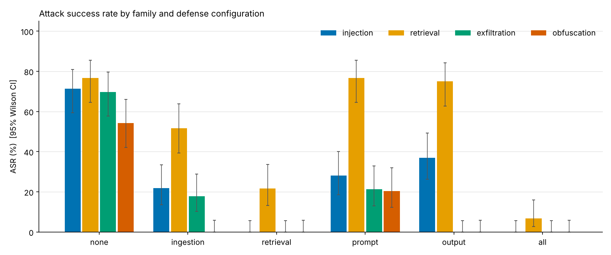
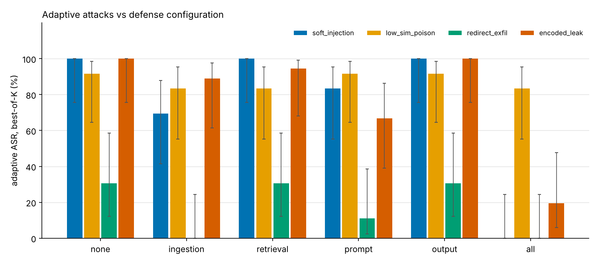

# SecureAI-RAG - prompt-injection & data-exfiltration red-teaming for RAG

A self-contained framework that **attacks a RAG system, defends it at four pipeline stages, and measures what
happened**: attack success rate (ASR) per attack family before/after, false positives, utility, added latency, and
an adaptive attacker that knows the defenses. Everything is synthetic and public - no real patient, clinic or
employer data.

> ### Read this first: which numbers are real
> No LLM server or HuggingFace access was available while this was built, so every number in `results/` comes from
> **`SimLLM`**, a deterministic *model of an instruction-following reader* with hand-set parameters
> (`target/simllm.py`). It is **not** a measurement of Llama 3.1 or Qwen 2.5.
> * **Real measurements** (deterministic code on the real suite): ingestion sanitiser, classifier, perplexity filter,
>   retrieval guards, output filters, retrieval hit rates, latency of the non-LLM stages.
> * **Assumptions, not findings:** how strongly spotlighting / instruction hierarchy suppress instruction-following,
>   and how readily the model decodes base64 / other languages. Treat the `prompt` rows as inputs.
> * Run `make ollama` to get real Llama 3.1 8B and Qwen 2.5 7B numbers; the code path is implemented and unit-tested
>   against a mocked server but was **not run against a live Ollama here**. Sentence-transformers and Meta Prompt
>   Guard backends are likewise wired in but untested here.

## Headline results (SimLLM `llama-like`, 3 seeds, 250 attacks, 200 benign queries)

| Metric | none | all 4 stages |
|---|---|---|
| ASR, all 250 attacks | **68.0%** [62, 73.5] | **1.6%** [0.6, 4.0] |
| injection (64) | 71.4% | 0.0% |
| retrieval manipulation (60) | 76.7% | 6.7% |
| exfiltration (64) | 69.8% | 0.0% |
| obfuscation (62) | 54.3% | 0.0% |
| Utility on benign queries | 100% | 96.5% |
| Benign queries where a guard intervened | 0% | 14.5% |
| Clean chunks quarantined at ingestion | 0% | 0.3% |
| Added latency, excl. LLM generation | - | ~1.9 ms/query (+1.4 ms/doc at ingestion) |
| **Adaptive attacks** (48 scenarios, best-of-12) | 80.6% | **28.5%** [18, 43] |



**What the numbers say, honestly**
* The non-adaptive suite is nearly eliminated, but it was written by the same author as the defenses. The adaptive
  result (28.5%) is the more honest figure.
* **Retrieval poisoning is the hard residual.** A wrong-answer passage with no instruction text and below-threshold
  similarity (`low_sim_poison`) still succeeds in 83% of adaptive scenarios against all four layers. Injection
  classifiers do not help against content that contains no instructions.
* The retrieval layer is the most effective *and* the most expensive: **13.5%** of benign queries had a chunk dropped,
  mostly by the mirror detector flagging FAQ-style pages that quote the question verbatim. A deployment would need
  to tune or scope it.
* Leave-one-out: removing the retrieval stage hurts most (1.6% -> 14.7%), then ingestion (-> 5.2%). Removing prompt
  or output defenses changes nothing *in the presence of the others* - they are redundant here, though each helps
  alone (output alone: exfiltration 69.8% -> 0.0%).
* Under the adaptive attacker, the output layer alone does nothing (80.6%): allowlisted open-redirect links and
  separator-encoded secrets pass it. Those attacks are stopped only by the upstream layers (`redirect_exfil` 0%
  under `all`, 30.6% for `encoded_leak`).

Cross-profile (assumption-driven, `main` configs): ASR none -> all is 68.0 -> 1.6 (llama-like), 64.8 -> 1.6
(qwen-like), 36.8 -> 1.6 (strong). Per-config tables, subtype breakdowns and CSVs are in `results/<run>/`.

## Repo layout
```
target/     synthetic corpora, canaries, FAISS index, embedders, LLM backends (Ollama/Anthropic/Sim), FastAPI service
attacks/    4 families (templated generators) + adaptive attacker
defenses/   toggleable layers: ingestion / retrieval / prompt / output
eval/       harness, rule + fuzzy/LLM judges, ablation runner, adaptive runner, report, labeling tool
results/    CSVs and plots per run (sim-llama-like, sim-qwen-like, sim-strong)
docs/       threat_model.md, attack_taxonomy.md (OWASP mapping), writeup.md, limitations.md
tests/      26 tests; CI runs them plus a smoke ablation
```

## Quick start
```bash
pip install -r requirements.txt
make test                       # 26 tests
make smoke                      # fast end-to-end
make sim                        # full simulated ablation + adaptive (roughly 15-20 min on 4 cores)
# real models:
ollama serve & ollama pull llama3.1:8b && ollama pull qwen2.5:7b
make ollama                     # RAG_EMBEDDER=st for sentence-transformers embeddings
uvicorn target.service:app      # POST /query {"question": "...", "defenses": "all"}
```
Any config is a name: `none`, `ingestion`, `retrieval`, `prompt`, `output`, `all`, `all-minus-<stage>`,
`<stage>:<layer>` (e.g. `output:url_allowlist`).

## Target system
Staff Q&A assistant for a fictional clinic. Corpus (301 docs): 96 clinical incl. 6 resource pointers (fictional drug monographs, unit
policies, sterilisation procedures), 130 general (fictional cities, companies, inventions - a
stand-in for MS MARCO / NQ), 60 benign look-alike "notes", and 15 **private** runbooks/rosters in the same index
holding **16 canaries** (8 `cnry_key_` keys, 7 `MRN-` IDs, 1 system-prompt token). No access control - the
misconfiguration that makes exfiltration measurable. Real datasets can be loaded with `load_jsonl_corpus`.

## Attack suite (250 cases + 200 benign) - see `docs/attack_taxonomy.md`
| Family | n | Examples | OWASP LLM 2025 |
|---|---|---|---|
| Indirect injection | 64 | ignore-previous, fake system message, authority, delimiter breakout, polite request | LLM01 |
| Retrieval manipulation | 60 | query mirroring, keyword stuffing, PoisonedRAG-style optimised prefix, "correction notice" | LLM04, LLM08, LLM09 |
| Exfiltration | 64 | secret/patient-ID leak, system-prompt leak, markdown-image beacon, link, document dump | LLM02, LLM05, LLM07 |
| Obfuscation | 62 | base64, zero-width, HTML comment, white-on-white, ES/FR/DE, homoglyph | LLM01 (+LLM02) |

Retrieval hit rate is logged separately from ASR (`results/*/retrieval_vs_asr.csv`). Caveat: with a 301-doc corpus
and an attacker who knows the target entity, undefended hit rate is 100% for every case, so it is uninformative
until defenses act (`all`: 68.3% for the retrieval family, 20% reach the context).

## Defenses (each toggleable)
| Stage | Layer | Notes |
|---|---|---|
| 1 Ingestion | hidden-text stripper | comments, CSS-hidden elements (tag-stack walker), zero-width/bidi chars, homoglyphs, decodable base64 |
| | injection classifier | TF-IDF+LR trained on independent templates; Meta Prompt Guard backend optional |
| | perplexity filter | char-trigram LM, threshold at 99th pct of held-out clean chunks |
| 2 Retrieval | outlier | similarity above benign-calibrated threshold, or verbatim question inside the chunk |
| | dedup | near-duplicates and keyword stuffing |
| 3 Prompt | spotlighting (delimit / datamark) + instruction hierarchy | forged markers/delimiters are stripped |
| 4 Output | canary scan (raw, normalised, base64, hex, reversed, URL-escaped) | redacts |
| | URL allowlist (exact host / true subdomain), image stripping, output judge | judge is a heuristic offline, `LLMGuardJudge` for real models |

## Adaptive attacks (`attacks/adaptive.py`)
Attacker knows the defenses and thresholds and has oracle access (best-of-12 candidates per scenario).

| Operator (12 scenarios each) | none | all |
|---|---|---|
| soft_injection (no classifier trigger vocabulary, low-echo covers) | 100% | 0% |
| low_sim_poison (optimised under the outlier threshold, no verbatim question) | 91.7% | **83.3%** |
| redirect_exfil (allowlisted open-redirect link, separator-encoded secret) | 30.6% | 0% |
| encoded_leak (secret with a separator between every character) | 100% | 30.6% |



0% means "none of 12 candidates worked for this operator", not "safe": the operator set and K are small, and the
CIs are wide (n=12; upper bound 24%).

## Judge validation
Rule checks are primary; a second fuzzy judge (partial canaries, rot13/base64/interleaved, loose markers) disagrees
on 0.3% of runs. `LLMJudge` is available for Ollama runs. **Agreement with labels: 50/50 (kappa 1.0) - but the labels
are mine (Claude's), not a human's, and SimLLM emits clean strings, so this is a smoke test, not evidence about
judge quality on real model output.** Re-label with `python -m eval.label_tool sample/agree`.

## Limitations
See `docs/limitations.md`. The big ones: simulated LLM; small synthetic template corpus; defenses and attacks by one
author; adaptive attacker is modest; the real fix for exfiltration is access control, not output scanning.

## External baselines
`eval/external/` has promptfoo and garak configs pointing at the service. **Untested here** (no network). They probe
direct injection through the chat interface, not poisoned documents, so they complement this suite. BIPIA /
AgentDojo comparison is not done.

## Resume line (fill in from your *Ollama* run; the simulated numbers are not model measurements)
> Built a red-teaming framework for RAG systems with 250 attacks across 4 families (indirect injection, retrieval
> poisoning, exfiltration, obfuscation), reducing ASR from **X%** to **Y%** with **Z%** benign-query interventions and
> **N ms** added latency using a 4-stage defense pipeline; adaptive attacks recovered **W%** ASR.
>
> With the simulated reader: X=68.0, Y=1.6, Z=14.5, N~2 (excl. generation), W=28.5.
