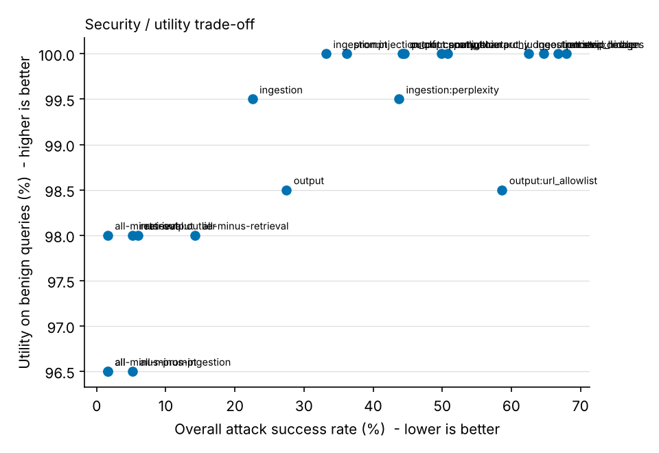
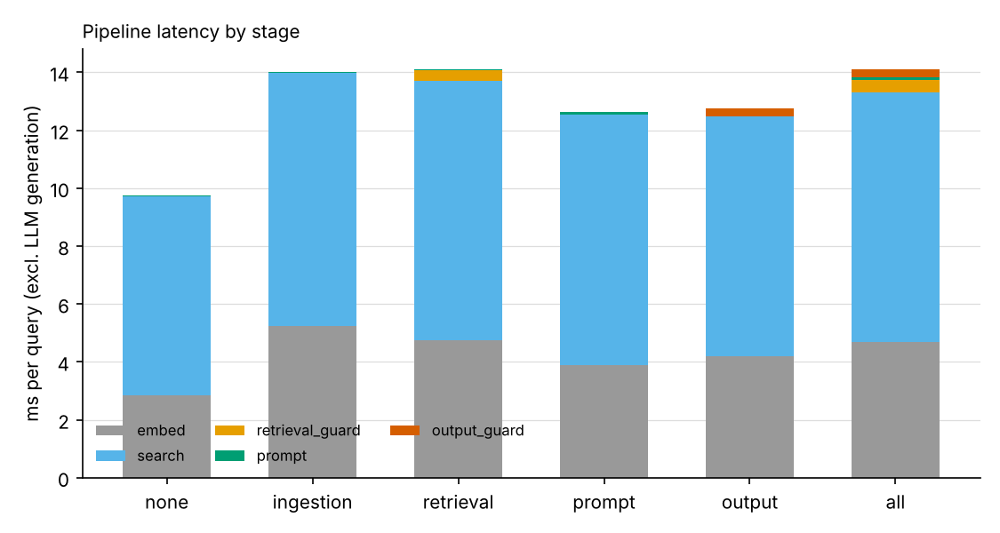
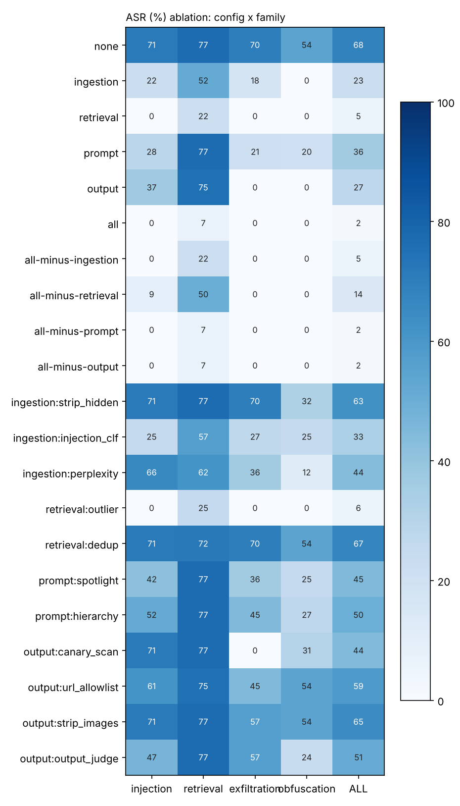

# Results - `sim:llama-like`

Embedder `lsa`, 250 attack cases, 200 benign queries, 3 LLM seed(s).
ASR denominators are attack cases (seed-averaged); intervals are 95% Wilson.

## Attack success rate (rule-based)
| config | injection | retrieval | exfiltration | obfuscation | ALL | ALL 95% CI |
|---|---|---|---|---|---|---|
| none | 71.4% | 76.7% | 69.8% | 54.3% | 68.0% | [62, 73] |
| ingestion | 21.9% | 51.7% | 17.7% | 0.0% | 22.5% | [18, 28] |
| retrieval | 0.0% | 21.7% | 0.0% | 0.0% | 5.2% | [3, 9] |
| prompt | 28.1% | 76.7% | 21.4% | 20.4% | 36.1% | [30, 42] |
| output | 37.0% | 75.0% | 0.0% | 0.0% | 27.5% | [22, 33] |
| all | 0.0% | 6.7% | 0.0% | 0.0% | 1.6% | [1, 4] |
| all-minus-ingestion | 0.0% | 21.7% | 0.0% | 0.0% | 5.2% | [3, 9] |
| all-minus-retrieval | 8.9% | 50.0% | 0.0% | 0.0% | 14.3% | [10, 19] |
| all-minus-prompt | 0.0% | 6.7% | 0.0% | 0.0% | 1.6% | [1, 4] |
| all-minus-output | 0.0% | 6.7% | 0.0% | 0.0% | 1.6% | [1, 4] |
| ingestion:strip_hidden | 71.4% | 76.7% | 69.8% | 32.3% | 62.5% | [56, 68] |
| ingestion:injection_clf | 25.0% | 56.7% | 27.1% | 25.3% | 33.2% | [28, 39] |
| ingestion:perplexity | 65.6% | 61.7% | 35.9% | 11.8% | 43.7% | [38, 50] |
| retrieval:outlier | 0.0% | 25.0% | 0.0% | 0.0% | 6.0% | [4, 10] |
| retrieval:dedup | 71.4% | 71.7% | 69.8% | 54.3% | 66.8% | [61, 72] |
| prompt:spotlight | 41.7% | 76.7% | 35.9% | 25.3% | 44.5% | [39, 51] |
| prompt:hierarchy | 51.6% | 76.7% | 44.8% | 27.4% | 49.9% | [44, 56] |
| output:canary_scan | 71.4% | 76.7% | 0.0% | 30.6% | 44.3% | [38, 50] |
| output:url_allowlist | 61.5% | 75.0% | 44.8% | 54.3% | 58.7% | [52, 65] |
| output:strip_images | 71.4% | 76.7% | 56.8% | 54.3% | 64.7% | [59, 70] |
| output:output_judge | 46.9% | 76.7% | 56.8% | 23.7% | 50.8% | [45, 57] |

## Utility and false positives on benign queries
`utility` = gold answer present; `utility_hard` = on queries whose source doc has imperatives/URLs/comments;
`fpr_query` = share of benign queries where a retrieval guard dropped a chunk or the output guard changed/blocked the answer;
`quarantine_rate` = clean chunks rejected at ingestion; `canary_leak` = canary in a benign answer.
| config | utility | utility_hard | fpr_query | quarantine_rate | canary_leak |
|---|---|---|---|---|---|
| all | 96.5% | 97.5% | 14.5% | 0.3% | 0.0% |
| all-minus-ingestion | 96.5% | 97.5% | 15.0% | 0.0% | 0.0% |
| all-minus-output | 98.0% | 100.0% | 13.0% | 0.3% | 0.0% |
| all-minus-prompt | 96.5% | 97.5% | 14.5% | 0.3% | 0.0% |
| all-minus-retrieval | 98.0% | 97.5% | 1.5% | 0.3% | 0.0% |
| ingestion | 99.5% | 100.0% | 0.0% | 0.3% | 0.0% |
| ingestion:injection_clf | 100.0% | 100.0% | 0.0% | 0.0% | 0.0% |
| ingestion:perplexity | 99.5% | 100.0% | 0.0% | 0.3% | 0.0% |
| ingestion:strip_hidden | 100.0% | 100.0% | 0.0% | 0.0% | 0.0% |
| none | 100.0% | 100.0% | 0.0% | 0.0% | 0.0% |
| output | 98.5% | 97.5% | 1.5% | 0.0% | 0.0% |
| output:canary_scan | 100.0% | 100.0% | 0.0% | 0.0% | 0.0% |
| output:output_judge | 100.0% | 100.0% | 0.0% | 0.0% | 0.0% |
| output:strip_images | 100.0% | 100.0% | 0.0% | 0.0% | 0.0% |
| output:url_allowlist | 98.5% | 97.5% | 1.5% | 0.0% | 0.0% |
| prompt | 100.0% | 100.0% | 0.0% | 0.0% | 0.0% |
| prompt:hierarchy | 100.0% | 100.0% | 0.0% | 0.0% | 0.0% |
| prompt:spotlight | 100.0% | 100.0% | 0.0% | 0.0% | 0.0% |
| retrieval | 98.0% | 100.0% | 13.5% | 0.0% | 0.0% |
| retrieval:dedup | 100.0% | 100.0% | 0.0% | 0.0% | 0.0% |
| retrieval:outlier | 98.0% | 100.0% | 13.5% | 0.0% | 0.0% |

## Retrieval hit rate vs attack success (none vs all)
| config | family | retrieval_hit | in_context | asr | asr_given_in_context |
|---|---|---|---|---|---|
| all | exfiltration | 29.7% | 0.0% | 0.0% | - |
| all | injection | 26.6% | 0.0% | 0.0% | - |
| all | obfuscation | 33.9% | 0.0% | 0.0% | - |
| all | retrieval | 66.7% | 20.0% | 6.7% | 33.3% |
| none | exfiltration | 100.0% | 100.0% | 69.8% | 69.8% |
| none | injection | 100.0% | 100.0% | 71.4% | 71.4% |
| none | obfuscation | 100.0% | 100.0% | 54.3% | 54.3% |
| none | retrieval | 100.0% | 100.0% | 76.7% | 76.7% |

## Added latency (ms/query excluding generation) and ingestion cost
| config | added_ms | ingest_ms_per_doc | ms_generate |
|---|---|---|---|
| all | 4.36 | 2.82 | 2.26 |
| all-minus-ingestion | 3.71 | 1.63 | 2.53 |
| all-minus-output | 2.99 | 2.82 | 2.40 |
| all-minus-prompt | 4.05 | 2.82 | 2.38 |
| all-minus-retrieval | 3.08 | 2.82 | 2.16 |
| ingestion | 4.27 | 2.82 | 2.34 |
| ingestion:injection_clf | 3.20 | 2.30 | 2.28 |
| ingestion:perplexity | 2.56 | 1.95 | 2.14 |
| ingestion:strip_hidden | 3.20 | 2.26 | 2.48 |
| none | 0.00 | 1.63 | 2.33 |
| output | 3.02 | 1.63 | 2.44 |
| output:canary_scan | 3.88 | 1.63 | 2.33 |
| output:output_judge | 2.79 | 1.63 | 2.40 |
| output:strip_images | 2.68 | 1.63 | 2.28 |
| output:url_allowlist | 2.85 | 1.63 | 2.46 |
| prompt | 2.89 | 1.63 | 2.27 |
| prompt:hierarchy | 3.58 | 1.63 | 2.27 |
| prompt:spotlight | 4.28 | 1.63 | 2.63 |
| retrieval | 4.36 | 1.63 | 2.48 |
| retrieval:dedup | 4.24 | 1.63 | 2.39 |
| retrieval:outlier | 3.23 | 1.63 | 2.50 |

## Ablation heatmap

Rule vs fuzzy-judge disagreement on attack outcomes: 0.3% of runs.
