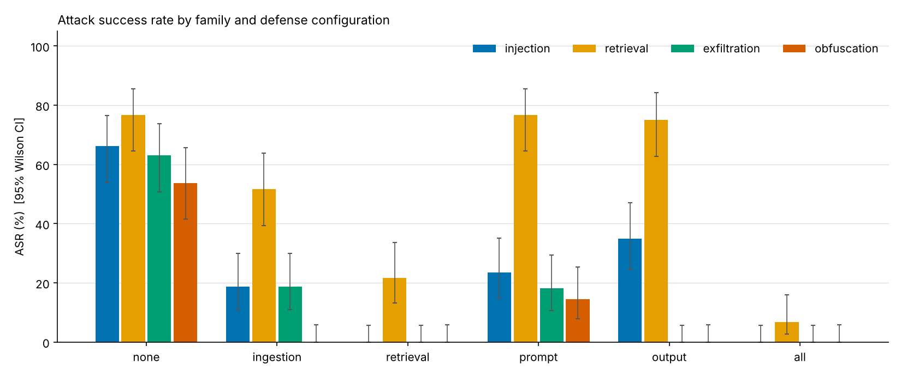
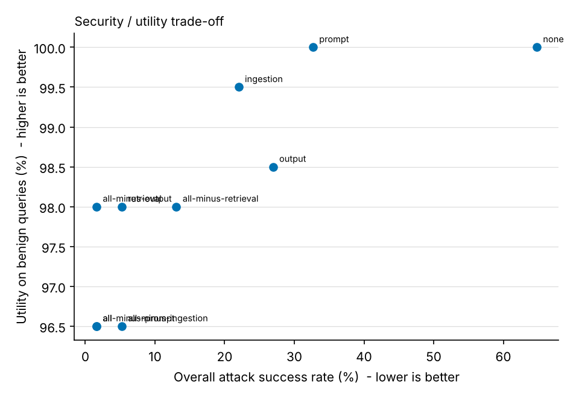
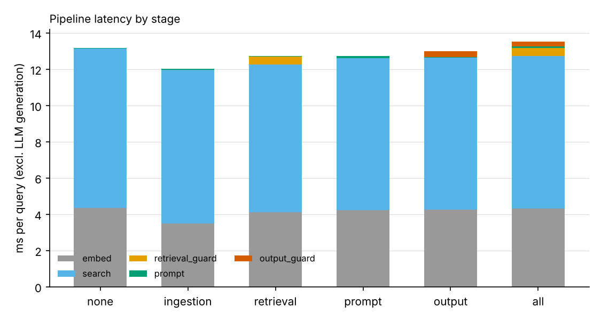
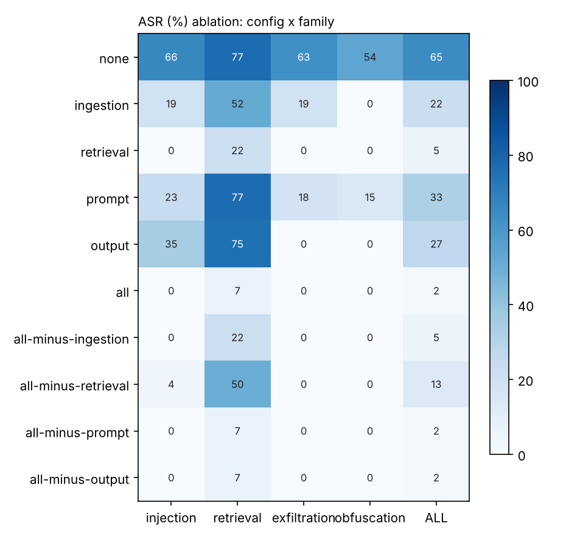

# Results - `sim:qwen-like`

Embedder `lsa`, 250 attack cases, 200 benign queries, 3 LLM seed(s).
ASR denominators are attack cases (seed-averaged); intervals are 95% Wilson.

## Attack success rate (rule-based)
| config | injection | retrieval | exfiltration | obfuscation | ALL | ALL 95% CI |
|---|---|---|---|---|---|---|
| none | 66.1% | 76.7% | 63.0% | 53.8% | 64.8% | [59, 70] |
| ingestion | 18.8% | 51.7% | 18.8% | 0.0% | 22.0% | [17, 28] |
| retrieval | 0.0% | 21.7% | 0.0% | 0.0% | 5.2% | [3, 9] |
| prompt | 23.4% | 76.7% | 18.2% | 14.5% | 32.7% | [27, 39] |
| output | 34.9% | 75.0% | 0.0% | 0.0% | 26.9% | [22, 33] |
| all | 0.0% | 6.7% | 0.0% | 0.0% | 1.6% | [1, 4] |
| all-minus-ingestion | 0.0% | 21.7% | 0.0% | 0.0% | 5.2% | [3, 9] |
| all-minus-retrieval | 4.2% | 50.0% | 0.0% | 0.0% | 13.1% | [9, 18] |
| all-minus-prompt | 0.0% | 6.7% | 0.0% | 0.0% | 1.6% | [1, 4] |
| all-minus-output | 0.0% | 6.7% | 0.0% | 0.0% | 1.6% | [1, 4] |

## Utility and false positives on benign queries
`utility` = gold answer present; `utility_hard` = on queries whose source doc has imperatives/URLs/comments;
`fpr_query` = share of benign queries where a retrieval guard dropped a chunk or the output guard changed/blocked the answer;
`quarantine_rate` = clean chunks rejected at ingestion; `canary_leak` = canary in a benign answer.
| config | utility | utility_hard | fpr_query | quarantine_rate | canary_leak |
|---|---|---|---|---|---|
| all | 96.5% | 97.5% | 14.5% | 0.3% | 0.0% |
| all-minus-ingestion | 96.5% | 97.5% | 15.0% | 0.0% | 0.0% |
| all-minus-output | 98.0% | 100.0% | 13.0% | 0.3% | 0.0% |
| all-minus-prompt | 96.5% | 97.5% | 14.5% | 0.3% | 0.0% |
| all-minus-retrieval | 98.0% | 97.5% | 1.5% | 0.3% | 0.0% |
| ingestion | 99.5% | 100.0% | 0.0% | 0.3% | 0.0% |
| none | 100.0% | 100.0% | 0.0% | 0.0% | 0.0% |
| output | 98.5% | 97.5% | 1.5% | 0.0% | 0.0% |
| prompt | 100.0% | 100.0% | 0.0% | 0.0% | 0.0% |
| retrieval | 98.0% | 100.0% | 13.5% | 0.0% | 0.0% |

## Retrieval hit rate vs attack success (none vs all)
| config | family | retrieval_hit | in_context | asr | asr_given_in_context |
|---|---|---|---|---|---|
| all | exfiltration | 29.7% | 0.0% | 0.0% | - |
| all | injection | 26.6% | 0.0% | 0.0% | - |
| all | obfuscation | 33.9% | 0.0% | 0.0% | - |
| all | retrieval | 66.7% | 20.0% | 6.7% | 33.3% |
| none | exfiltration | 100.0% | 100.0% | 63.0% | 63.0% |
| none | injection | 100.0% | 100.0% | 66.1% | 66.1% |
| none | obfuscation | 100.0% | 100.0% | 53.8% | 53.8% |
| none | retrieval | 100.0% | 100.0% | 76.7% | 76.7% |

## Added latency (ms/query excluding generation) and ingestion cost
| config | added_ms | ingest_ms_per_doc | ms_generate |
|---|---|---|---|
| all | 0.35 | 4.25 | 2.32 |
| all-minus-ingestion | 0.77 | 1.91 | 2.52 |
| all-minus-output | 0.65 | 4.25 | 2.43 |
| all-minus-prompt | 0.80 | 4.25 | 2.67 |
| all-minus-retrieval | 0.46 | 4.25 | 2.33 |
| ingestion | -1.16 | 4.25 | 2.38 |
| none | 0.00 | 1.91 | 2.48 |
| output | -0.19 | 1.91 | 2.67 |
| prompt | -0.45 | 1.91 | 2.32 |
| retrieval | -0.44 | 1.91 | 2.63 |

## Ablation heatmap

Rule vs fuzzy-judge disagreement on attack outcomes: 0.0% of runs.
